# apps.zlex.me

Games and apps for general use, each on its own address. Every one installs from the browser on a phone, tablet or laptop, with no store and no download.
[apps.zlex.me](https://apps.zlex.me) lists them; this repo shows what each one does, how they're hosted and what's next.

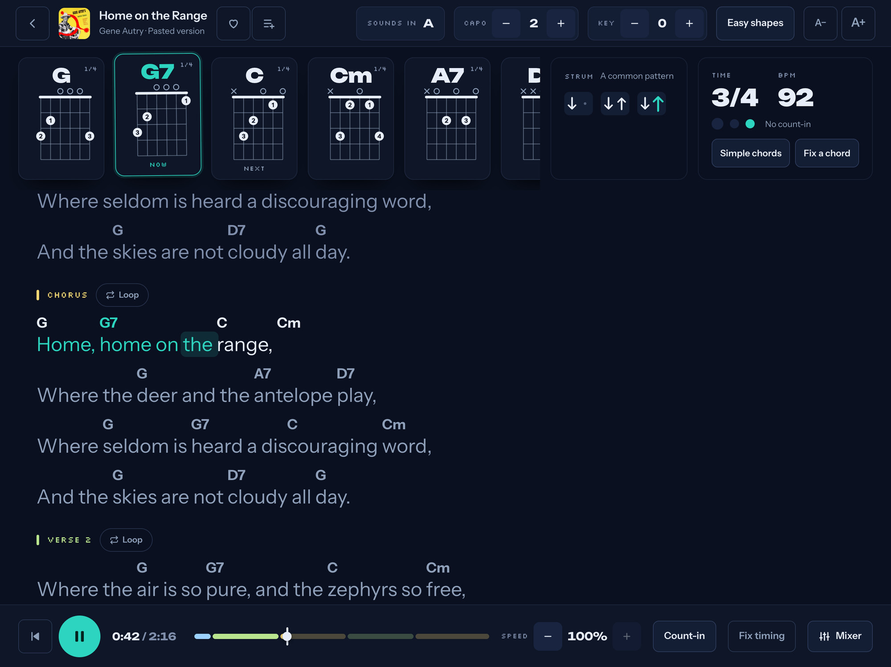

## Games

### [Puzzles](https://apps.zlex.me/puzzles/)

Six puzzles in one app, laid out like a page of newsprint: Codewords, Sudoku, Crosswords, Arrowwords, Wordsearch and Fill-ins. Each has a Daily, the same for everyone that day, and as many more as you want. Free, no account, plays offline. **Play them at [play.zlex.me](https://play.zlex.me).**

- **With friends.** Host a room and up to eight friends play the same puzzle, each on their own phone: a race to finish first, one grid solved together, or a claim for every square and word.
- **One answer each.** Sudoku and Fill-ins are made ahead and proved to have exactly one answer by a solver of their own, and every Sudoku is graded by the hardest step it needs, so none needs a guess.

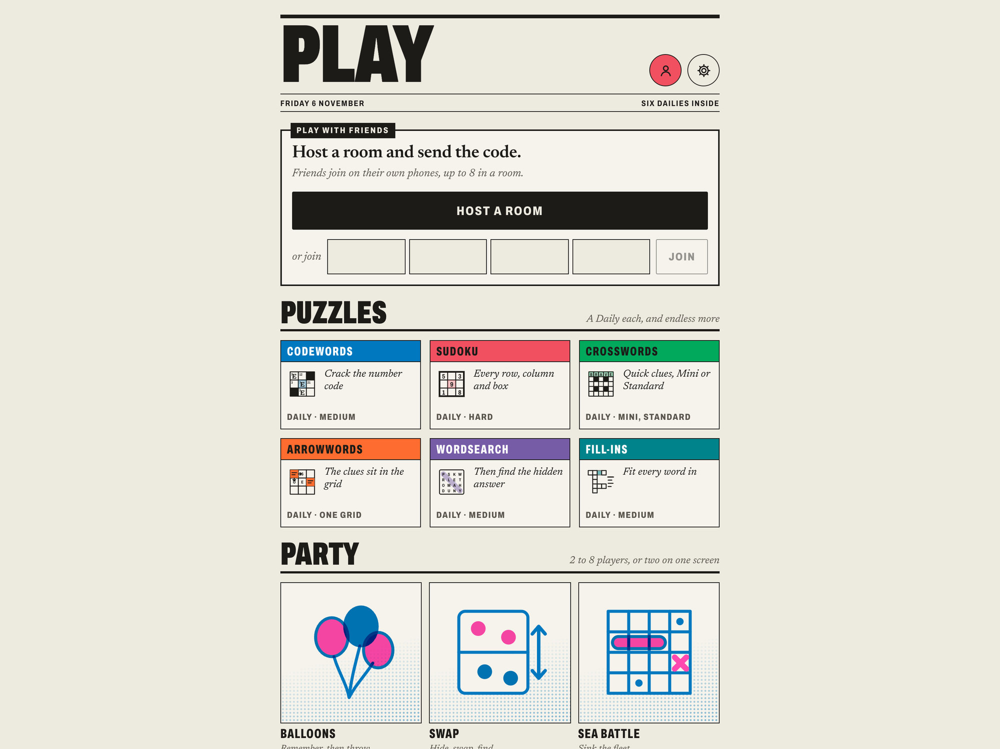

  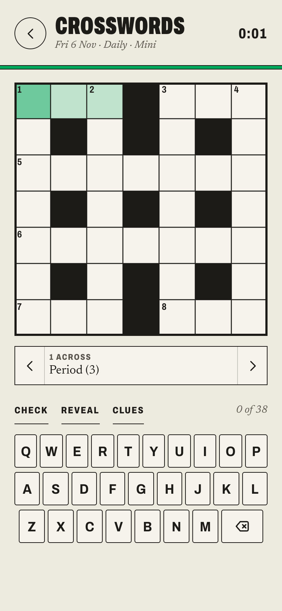
  &nbsp;&nbsp;
  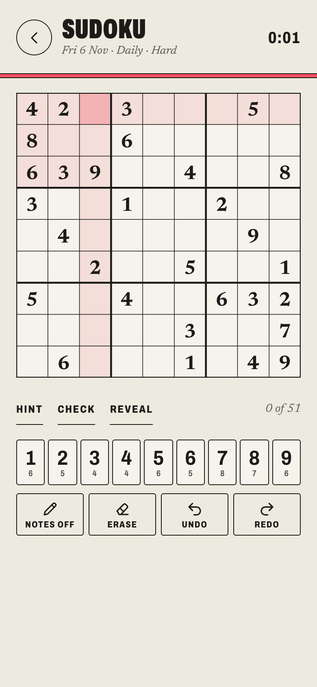

### [Party games](https://apps.zlex.me/party/)

Six quick games for 2 to 8 players: Balloons, Swap, Sea battle, Pin, Hide and Flash, each a few short rounds of remembering, guessing or hunting. Everyone joins on their own phone with a four-letter code or a QR code, the host picks a game, and every phone counts 3, 2, 1 together. Two can share one iPad, a half each, and every game has a Practice to try alone first. Free, no account, nothing to download. **Play them at [play.zlex.me](https://play.zlex.me).**

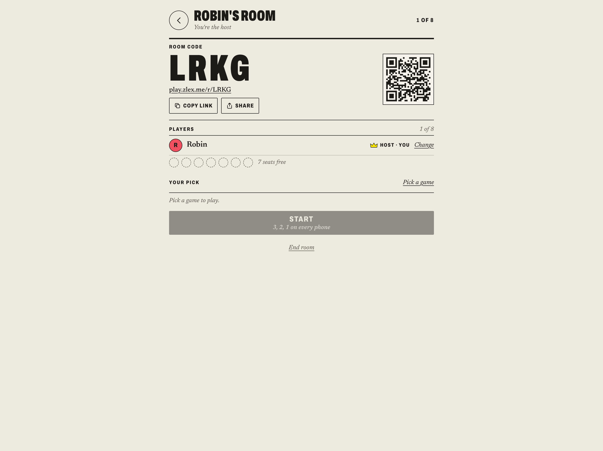

  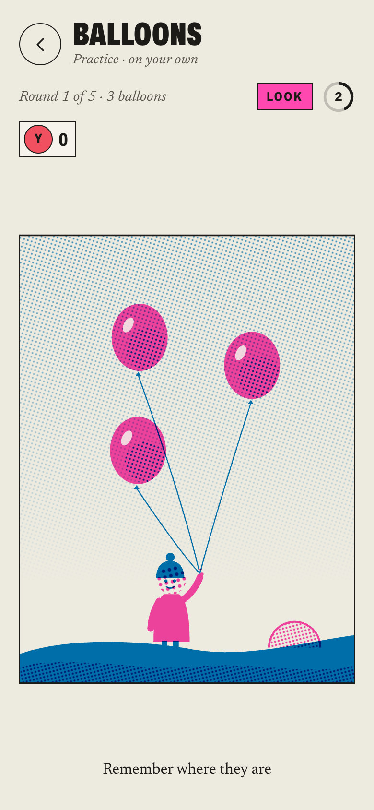
  &nbsp;&nbsp;
  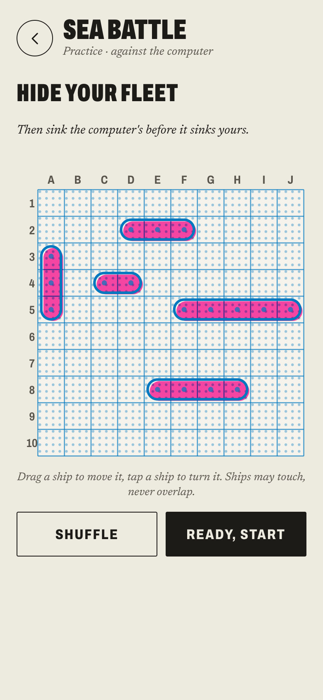

**An Install button in Play's Settings,** for the puzzles and the party games: one click in Chrome and Edge, the steps for your device in Safari, and gone once it's installed.

**How Play is built:** Vite, React and TypeScript, served by one Cloudflare Worker with static assets. Each room is a Durable Object found by its code, holding every phone's connection, so a quiet room sleeps and costs nothing. The room referees every move; the phones only draw.

### [Gemlight](https://gemlight.zlex.me)

A puzzle game: nine pieces with holes in them, a frame of 36 squares and ten gem marks. Fit every piece so each gem shows through a hole and lights up, with no two pieces of one colour touching. Every puzzle has exactly one solution: a Daily for everyone, a Journey from easy to hard, Endless, and a Race for two on one screen. Free, no account, plays offline. **Play it at [gemlight.zlex.me](https://gemlight.zlex.me)**; Google Play is next. Its Settings has an Install button: one click in Chrome and Edge, the steps for your device in Safari, and gone once it's installed.

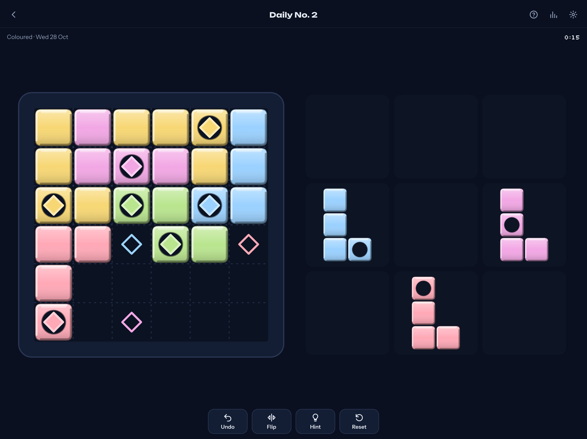

  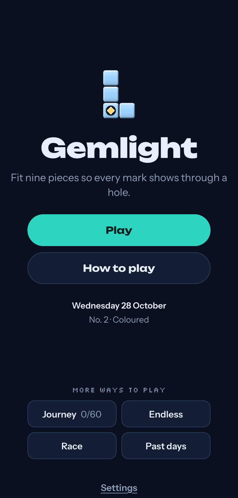
  &nbsp;&nbsp;
  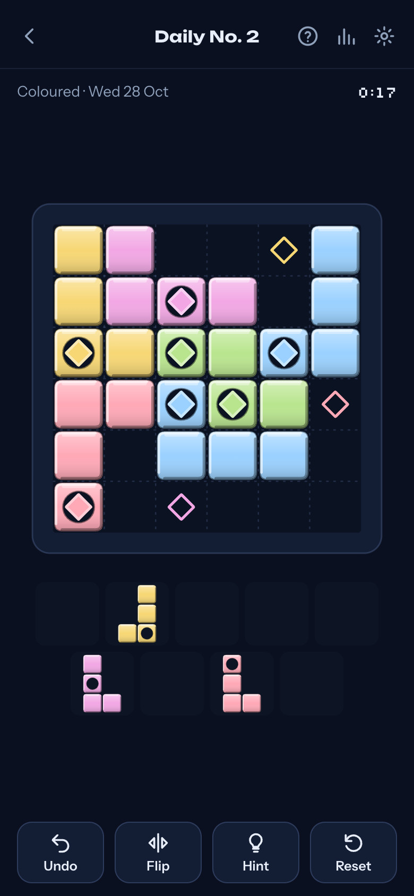

**How it's built:** a static TypeScript web app. Its generator makes the puzzles and its solver proves each one has a single solution; a service worker keeps it playable offline.

## Apps

### [Planner](https://planner.zlex.me)

A calendar you draw on, made for the iPad and its Pencil. Each month is a real sheet of boxes: write in them, draw across them, add stickers and washi tape, and give every page its own look. Free, no account, works offline. **Open it at [planner.zlex.me](https://planner.zlex.me).**

- **Ink first.** The Pencil always draws, with pressure, and never selects or opens anything. Your palm does nothing. A finger taps a box to open that day, pinches to zoom and swipes to the next month.
- **A look for every page.** 14 looks, from pink gingham and lilac clouds to plain paper. Change the paper, the boxes, the month name or the colour for one page, one month or every month. Ink and stickers take the page's colours, and the boxes never move.
- **Year, Month, Week and Day,** plus loose pages: blank, lined, dots, grid, lists and a habit tracker.
- **Stickers, tape, pictures and text,** with your own pictures as stickers or as the paper itself.
- **Events and reminders.** Times, repeats and birthdays, as real notifications once it's on the Home Screen.
- **Extras you switch on:** moods, habits, school deadlines, countdowns, moon phases, a sticker maker and more. A private one stays hidden until you ask, never shows on a saved page, and can be locked with a PIN.
- **Yours to keep.** Any page saves as a picture or a PDF, and one backup file holds everything.
- **An Install button in Settings:** one click in Chrome and Edge, the steps for your device in Safari, and gone once it's installed.

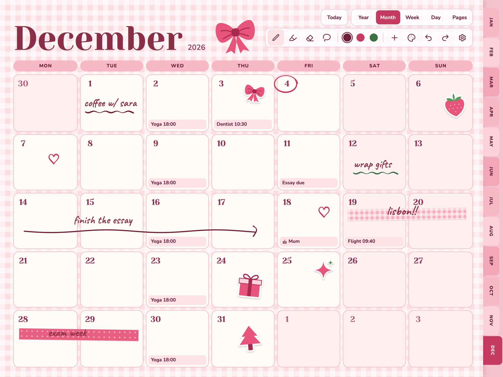

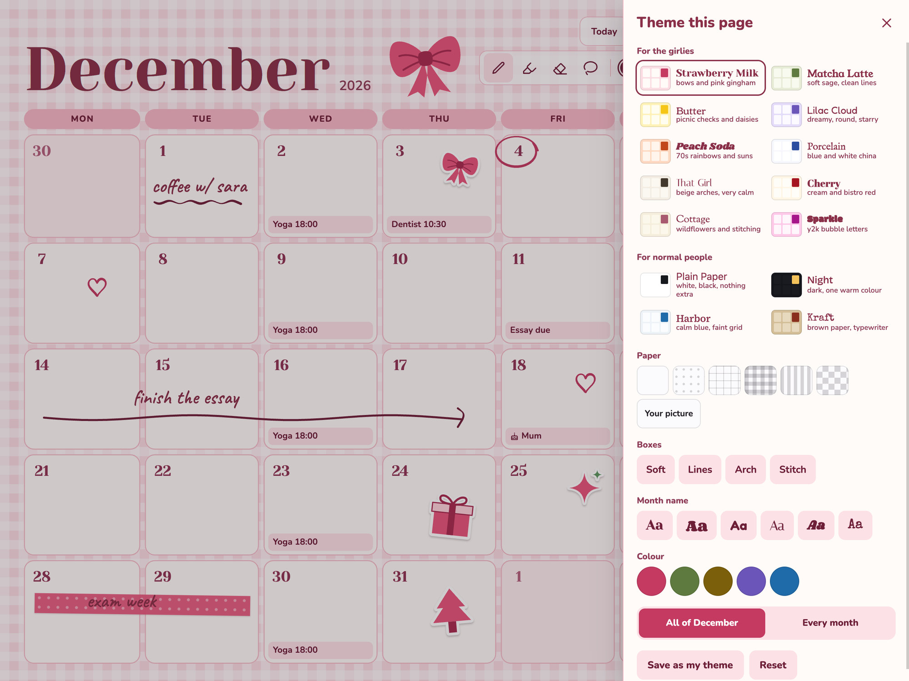

  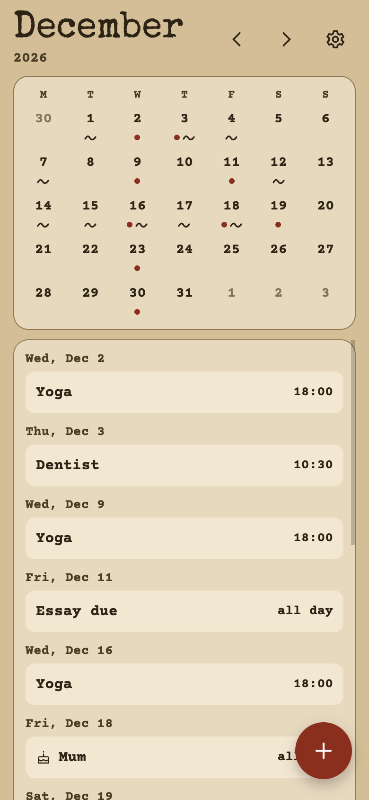
  &nbsp;&nbsp;
  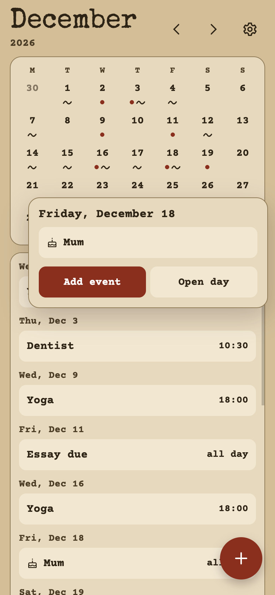

**How it's built:** a home-screen web app (React, TypeScript, Canvas 2D, IndexedDB). One renderer draws every page on screen, as a saved picture and as a PDF, so a saved page can't differ from what you see. A stroke is never edited, only added or erased, which is what lets two devices merge their ink once sync opens. A Cloudflare Worker with a small database sends the reminders.

### Strum

A guitar songbook, laid out for the iPad. **Private for now; a public version is planned.**

- **Chords with finger diagrams.** Every chord in the song is a card, in the order the song plays them. The one being played is lit, and the next one lights a beat before the change.
- **Every version of a song.** Each with its capo, the key it sounds in, how hard it is and its chords. A version that doesn't match the recording (usually a missing capo) is flagged, and any version can move to another key or to an easier capo with open shapes.
- **Words lit as they're sung.** The page scrolls with the song: the current line is bright and each word fills in as it's sung.
- **Backing parts, each with its own volume.** Vocals, guitar, drums, bass and the rest, plus a soft melody guide and a click. Slow the song down to half speed and it stays in the same key.
- **Strumming patterns lit in time.** The pattern for the part being played, each stroke lit on the beat.
- **Set lists and favourites.** Lists to fill and play in order, with the next song one tap away.

It also keeps the screen awake while a song is open, counts you in, loops a section, and opens without a connection. Its Settings has an Install button: one click in Chrome and Edge, the steps for your device in Safari, and gone once it's installed.

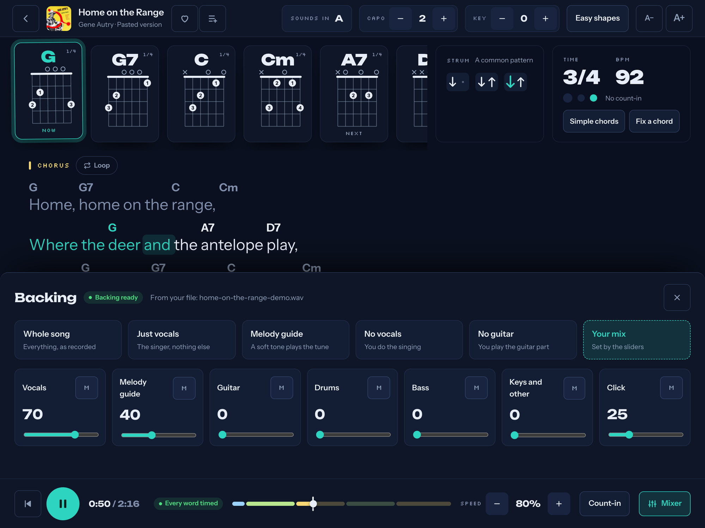

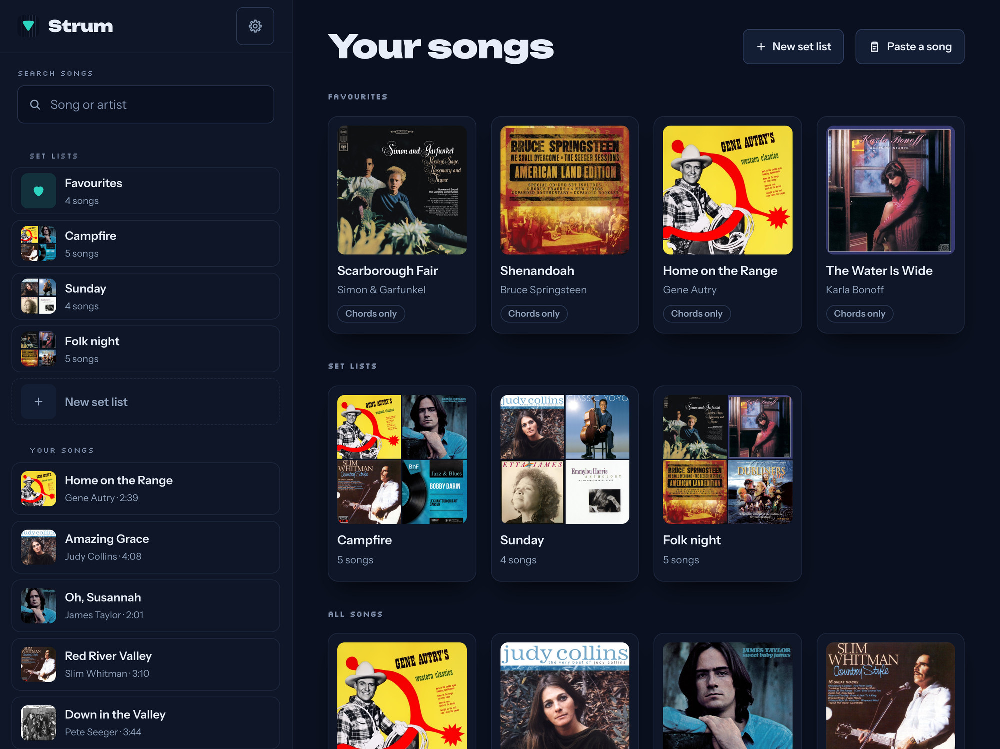

  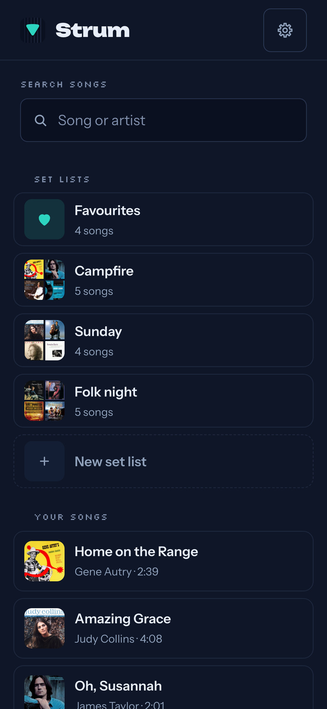
  &nbsp;&nbsp;
  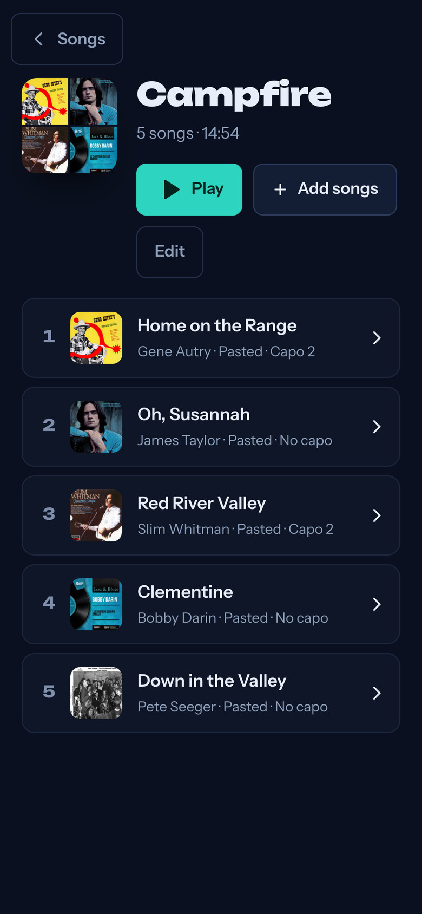

**How it's built:** a home-screen web app (React, TypeScript, Web Audio, IndexedDB) plus a helper on a Mac for the heavy work. Demucs splits a song into parts, Whisper times every word against the vocals, librosa finds the beat, and a pitch shifter (Signalsmith Stretch) keeps slowed-down parts in key. Songs, versions and backing parts are kept on the iPad, so a saved song plays while the Mac sleeps.

### Rounds

Daily tasks: a shift that says if the rest still fits, plus to-dos, routines and shared lists. **Private.**

- **A shift with a clock on each task.** As the shift goes, it shows how much spare time is left, so you can tell whether the rest still fits.
- **To-dos with reminders, and routines** that come back on their days.
- **Lists two people can share,** such as the groceries.

Made for a phone, and it works offline. Its Settings has an Install button: one click in Chrome and Edge, the steps for your device in Safari, and gone once it's installed.

  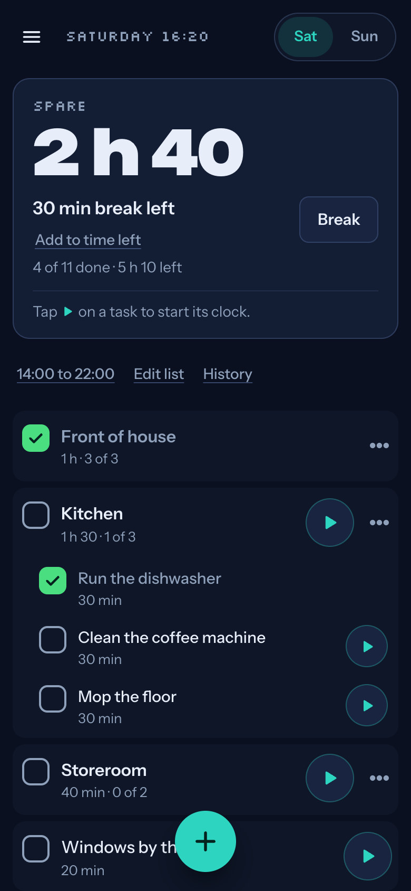
  &nbsp;
  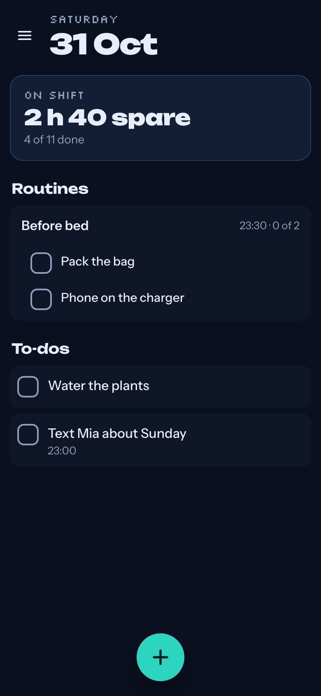
  &nbsp;
  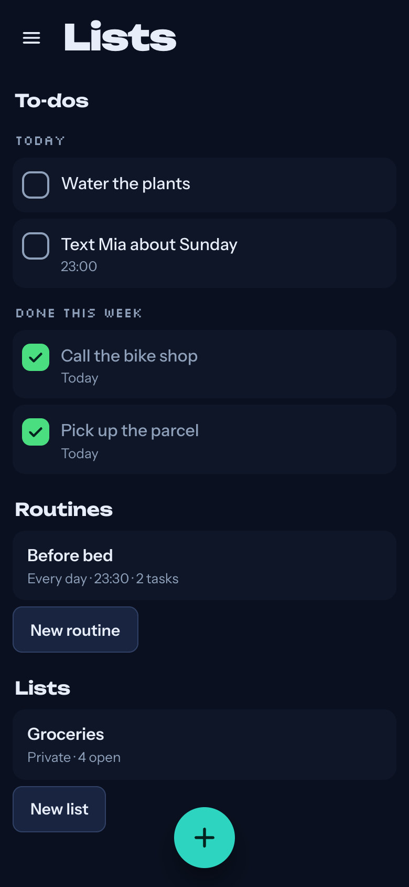

The pictures show a made-up shift and lists.

**How it's built:** a home-screen web app (React, TypeScript, Vite) with an offline copy in IndexedDB that syncs through a Cloudflare Worker with a D1 database, behind Cloudflare Access. A job that runs every minute sends the reminders as web push.

### Kickoff

A planner where a unit of work is one Claude Code chat: every project keeps its next chat written and waiting, and you book them onto days. **Private: it plans one person's own work.**

- **The next chat, always written.** Each project has one, a title and a brief: the goal, where to start, when it's done and the first step. The chat that last worked on the project writes it before it ends, so no chat starts from nothing.
- **Booked onto days.** Tap a project on the shelf to book its next chat for today, tomorrow or any day, with a time if you want a reminder then. There's no cap and no red: a chat you didn't get to turns grey and comes first on the shelf next time.
- **Start, then Enter.** On the Mac, Start opens the Claude desktop app on a new chat in the project's folder with the brief already in the box. On the phone, Copy prompt copies it for a chat that's already open.
- **Chats keep it up to date.** As a chat ends, it marks itself done with one line on what got done, writes its project's next chat and offers to book it, all through a small `kickoff` command.
- **The month fills in.** Year, Month, Week and Day show the chats in their projects' colours, and a done one keeps its line and a link that reopens the chat.
- **Reminders, shifts and deadlines.** A booked time sends a notification. A weekly work shift and course deadlines from Canvas show on their days.
- **Quiet sound and motion.** A soft sound when a chat starts, lands on a day or turns done while the page is open. Sheets rise and settle, and pages slide the way you went.
- **An Install button in Settings:** one click in Chrome and Edge, the steps for your device in Safari, and gone once it's installed.

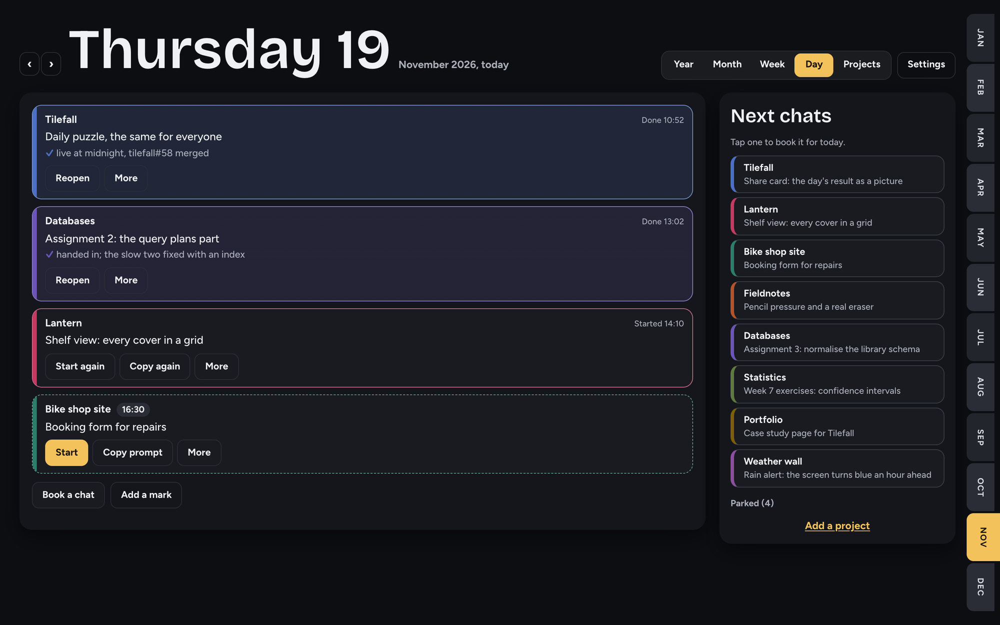

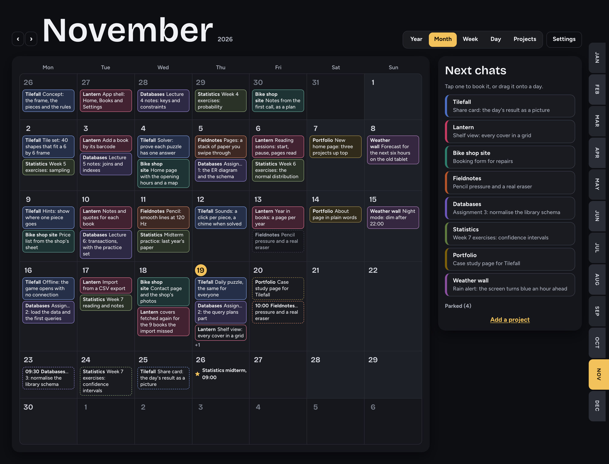

  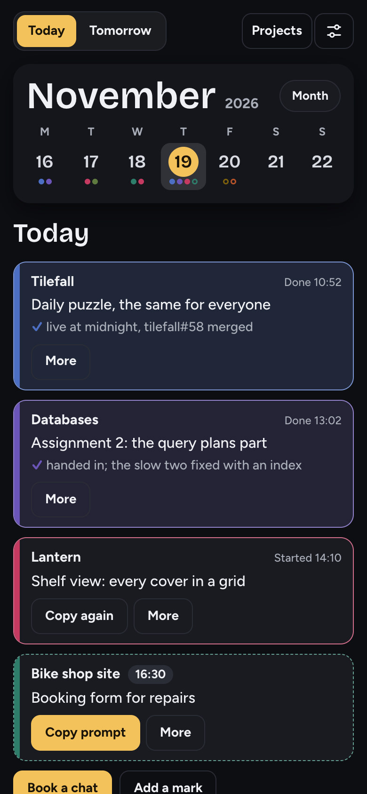
  &nbsp;
  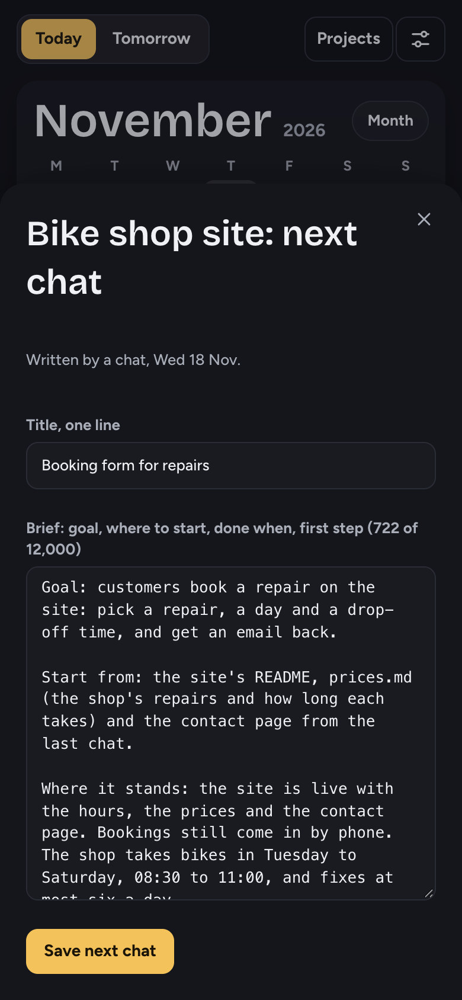
  &nbsp;
  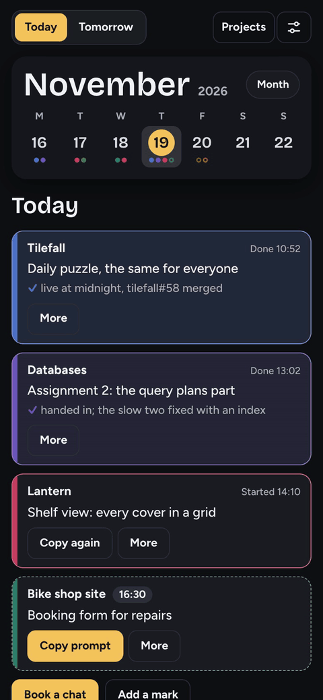

The pictures show a made-up plan.

**How it's built:** a home-screen web app (React, TypeScript, Vite) that keeps an offline copy of the plan and a queue of changes not yet sent, so it opens and books without a connection. A Cloudflare Worker with a D1 database keeps the plan behind Cloudflare Access, and a job that runs every minute sends the reminders as web push. Start is a `claude://code/new?q=` link, which the Claude desktop app opens as a new Code chat with the prompt typed in, not yet sent. The `kickoff` command has its own Access service token, and the Worker lets it do four things only: read the plan, write a next chat, book one and mark one done. The pages, the month tabs and the looks come from Planner.

## The start page: [apps.zlex.me](https://apps.zlex.me)

One address for everything: a tile per app with its icon, its name and a line about it, opening the app at its own address. Each app keeps its own icon and its own progress, so the start page is where you find the apps, not where you play them. It's open to everyone and shows the public apps. Signed in, you also see the private apps you have, marked Yours, and no others, so nobody is sent to a sign-in they can't pass. A Showcase page shows every game and app in this order, with screenshots, next to a short form to ask for access, and each app's own page has an Install guide that opens on your device.

**How it's built:** plain HTML, CSS and JavaScript, no framework and no build step. One data file lists the apps. A small Cloudflare Worker answers who is signed in and takes the form's posts, behind a Turnstile check and a rate limit.

## How it's hosted

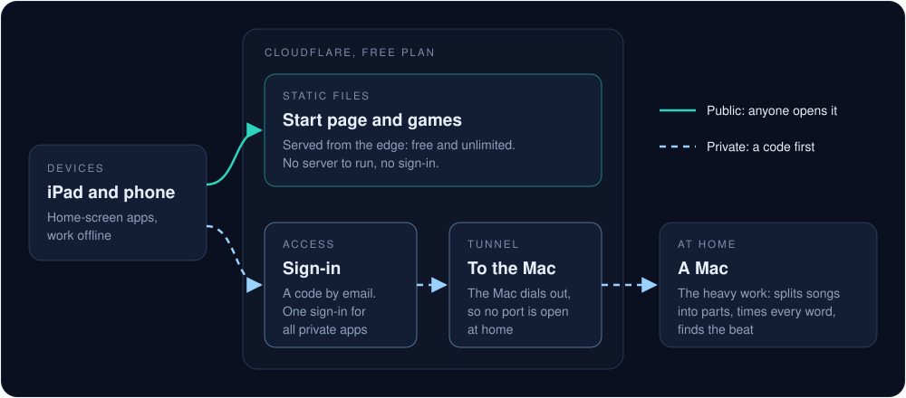

- **Static apps on Cloudflare's free plan.** The start page and the games are plain files served from Cloudflare's edge (Workers with static assets). Requests for static files are free and unlimited, so a game costs nothing to serve, however many people play it.
- **A small server only where an app needs one.** Planner's reminders come from a Cloudflare Worker with a D1 database and a job that runs every minute. Without an account it keeps when to remind a device, never what about: the notification carries an id, and the device fills in the words when it arrives. Play's rooms are Durable Objects, one per room, that hold every phone's connection and sleep when the room goes quiet.
- **Heavy work on a Mac, through a tunnel.** Splitting a song into parts and timing its words needs a real machine, so it runs on a Mac at home, reached through a Cloudflare Tunnel. The Mac makes the connection outward, so no port is open at home.
- **Private apps behind Cloudflare Access.** A private app asks for a code sent to an email on its list, and one sign-in covers every private app. A program can get in too, with a service token of its own, as Kickoff's command does from the Mac. Public apps have no sign-in at all.
- **One subdomain per app.** Each app has its own address, so each keeps its own storage, its own home-screen icon and its own offline copy.

Hosting all of it costs nothing today.

## On any device

- **Install from the browser.** Every app installs the browser's own way: on an iPhone or iPad, Safari's Share, then Add to Home Screen; on Android, Chrome's Install app; on a Mac, Safari's File, then Add to Dock, or the install button in Chrome or Edge; on Windows and Linux, Chrome or Edge. It gets its own icon and window, full screen on a phone or tablet, and works offline. Each app's page on apps.zlex.me has the steps for your device, and [apps.zlex.me/install](https://apps.zlex.me/install/) has them for any app. Home-screen web apps can also send notifications and badge their icon (iOS and iPadOS 16.4 and later).
- **Store apps, in steps.** Google Play first, for Gemlight, which can ship there as the same web app (a Trusted Web Activity). The App Store only for an app with real native parts: Apple turns down apps that are a web page in a wrapper.

## What's next

- **Gemlight on Google Play:** the same web app, packaged for Android.
- **A public Strum:** being planned, including what it takes to split songs for everyone instead of on one Mac.
- **No accounts to start:** progress stays on each device. Sign-in comes only when an app needs it, to sync between devices or to play together.
- **Each new game or app** starts as a written concept, gets its own subdomain and lands on the start page as one tile.

The apps' code is private; this repo is their showcase.
