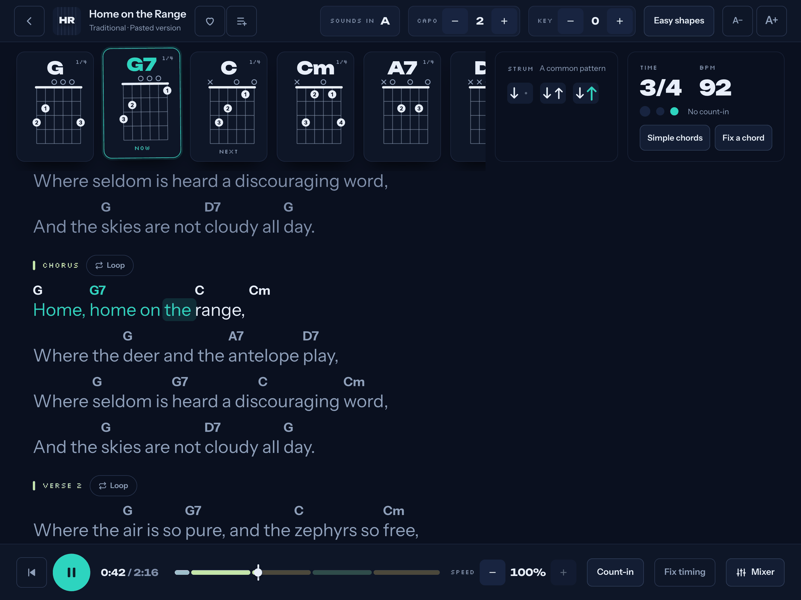
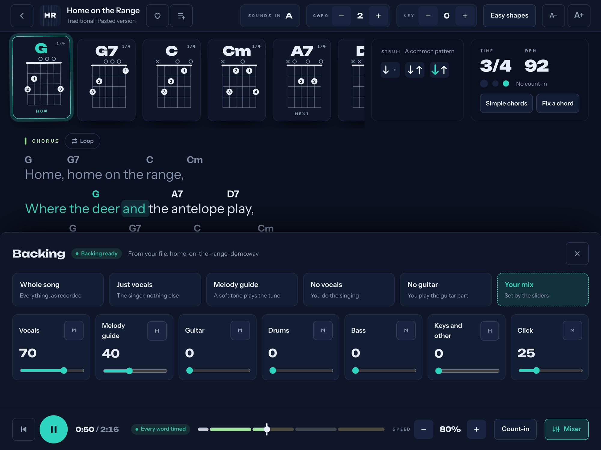
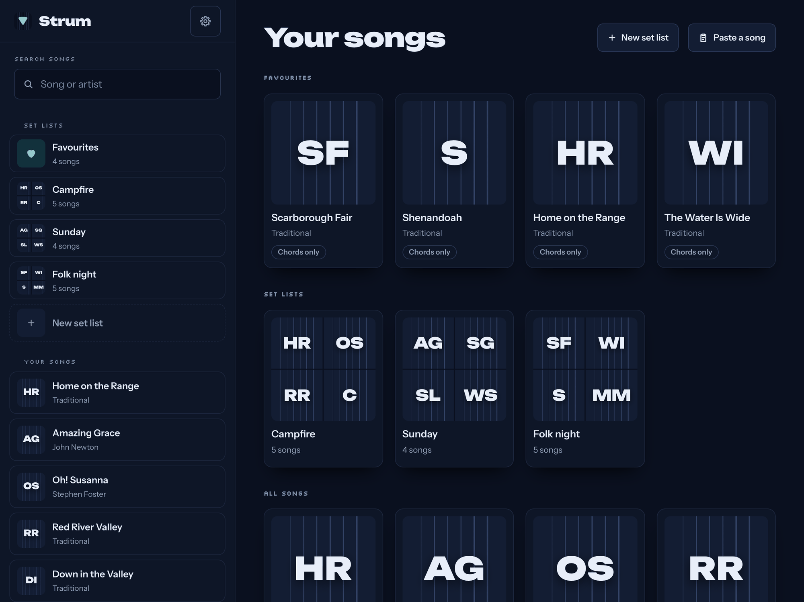
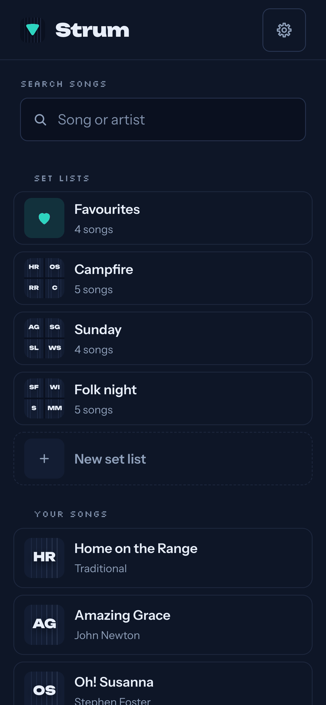
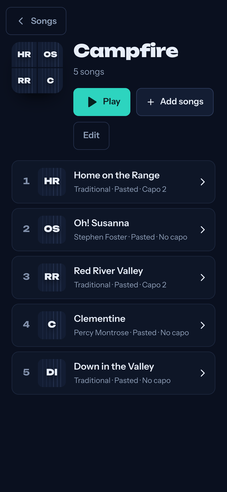
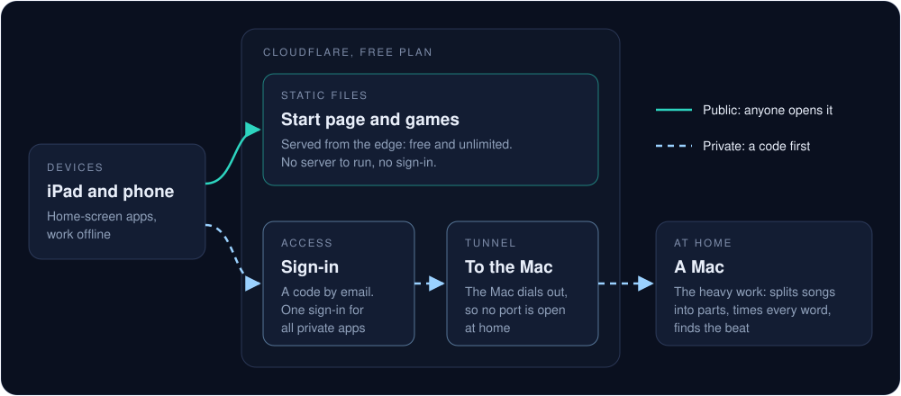

# apps.zlex.me

Games and apps for general use, each on its own address and made to live on an iPad or phone home screen.
One start page lists them; this repo shows what each one does, how they're hosted and what's next.

## The apps

### Strum

A guitar songbook, laid out for the iPad. **Private for now; a public version is planned.**

- **Chords with finger diagrams.** Every chord in the song is a card, in the order the song plays them. The one being played is lit, and the next one lights a beat before the change.
- **Every version of a song.** Each with its capo, the key it sounds in, how hard it is and its chords. A version that doesn't match the recording (usually a missing capo) is flagged, and any version can move to another key or to an easier capo with open shapes.
- **Words lit as they're sung.** The page scrolls with the song: the current line is bright and each word fills in as it's sung.
- **Backing parts, each with its own volume.** Vocals, guitar, drums, bass and the rest, plus a soft melody guide and a click. Slow the song down to half speed and it stays in the same key.
- **Strumming patterns lit in time.** The pattern for the part being played, each stroke lit on the beat.
- **Set lists and favourites.** Lists to fill and play in order, with the next song one tap away.

It also keeps the screen awake while a song is open, counts you in, loops a section, and opens without a connection.

  
  &nbsp;&nbsp;
  

**How it's built:** a home-screen web app (React, TypeScript, Web Audio, IndexedDB) plus a helper on a Mac for the heavy work. Demucs splits a song into parts, Whisper times every word against the vocals, librosa finds the beat, and a pitch shifter (Signalsmith Stretch) keeps slowed-down parts in key. Songs, versions and backing parts are kept on the iPad, so a saved song plays while the Mac sleeps.

### Gemlight (coming)

A puzzle game of punched card: nine pieces, a frame of 36 squares and ten gem marks. Fit every piece so each gem shows through a hole and lights up, with no two pieces of one colour touching. Every puzzle has exactly one solution: a Daily for everyone, a Journey from easy to hard, Endless, and a Race for two on one screen. Free, no account, plays offline. Coming to gemlight.zlex.me first, then Google Play.

**How it's built:** a static TypeScript web app. Its generator makes the puzzles and its solver proves each one has a single solution; a service worker keeps it playable offline.

### apps.zlex.me, the start page

One address for everything: a tile per app with its icon, its name and a line about it, opening the app at its own address. Each app keeps its own home-screen icon and its own progress, so the start page is where you find the apps, not where you play them. It opens to everyone with Gemlight; private apps stay on it, marked Private.

**How it's built:** plain HTML, CSS and JavaScript, no framework and no build step. One data file lists the apps.

## How it's hosted

- **Static apps on Cloudflare's free plan.** The start page and the games are plain files served from Cloudflare's edge (Workers with static assets). Requests for static files are free and unlimited, so a game costs nothing to serve, however many people play it.
- **Heavy work on a Mac, through a tunnel.** Splitting a song into parts and timing its words needs a real machine, so it runs on a Mac at home, reached through a Cloudflare Tunnel. The Mac makes the connection outward, so no port is open at home.
- **Private apps behind Cloudflare Access.** A private app asks for a code sent to an email on its list, and one sign-in covers every private app. Public apps have no sign-in at all.
- **One subdomain per app.** Each app has its own address, so each keeps its own storage, its own home-screen icon and its own offline copy.

Hosting all of it costs nothing today.

## On the iPad and phone

- **Home-screen web apps, now.** Open an app in Safari, then Share › Add to Home Screen: it gets its own icon, opens full screen and works offline. Home-screen web apps can also send notifications and badge their icon (iOS and iPadOS 16.4 and later).
- **Store apps, in steps.** Google Play first, for Gemlight, which can ship there as the same web app (a Trusted Web Activity). The App Store only for an app with real native parts: Apple turns down apps that are a web page in a wrapper.

## What's next

- **apps.zlex.me opens to everyone:** the public games and apps on one page, private ones marked Private.
- **Gemlight:** on the web first, then Google Play.
- **A public Strum:** being planned, including what it takes to split songs for everyone instead of on one Mac.
- **No accounts to start:** progress stays on each device. Sign-in comes only when an app needs it, to sync between devices or to play together.
- **Each new game or app** starts as a written concept, gets its own subdomain and lands on the start page as one tile.

The apps' code is private; this repo is their showcase.
